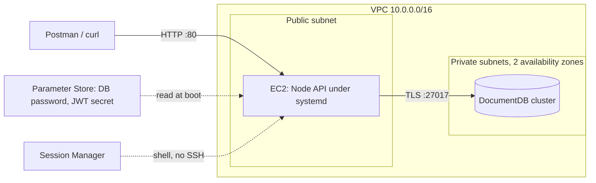

# UnQue appointment API

A small API for a college appointment system. Professors publish the times they are free, students book those slots, and professors can move a free slot or cancel a booking.

This is my submission for the UnQue internship assignment. I started from the provided code ([shivamquincy/UnQue-2.0](https://github.com/shivamquincy/UnQue-2.0)), fixed what I found wrong in it, added the new endpoint, moved it from MongoDB to Amazon DocumentDB, and deployed it on EC2 with Terraform.

## What the assignment asked for, and where to find it

| Task | Where |
| --- | --- |
| New API to update a free slot without removing it | `PATCH /professor/availability/:slotId` in [`controllers/proff.js`](controllers/proff.js) |
| Use DocumentDB instead of MongoDB | [`config/db.js`](config/db.js) and [`config/env.js`](config/env.js) |
| Deploy on EC2, with EC2 talking to DocumentDB | [`infra/terraform`](infra/terraform) and [`scripts`](scripts) |
| Run the flow in Postman against EC2 | [`postman`](postman) and [`scripts/smoke-test.sh`](scripts/smoke-test.sh) |

## How it is deployed



- The API runs on one EC2 instance in a public subnet, as a systemd service under its own unprivileged user. The code is owned by root, so the app can't modify itself.
- DocumentDB sits in two private subnets (it needs two availability zones). Its security group only accepts connections from the API's security group, so nothing else can reach port 27017.
- The connection uses TLS with AWS's CA bundle, and the cluster refuses anything older than TLS 1.2.
- The database password and the JWT secret are generated by Terraform and stored in Parameter Store. The server reads them when it boots. They are never in git or in the instance's user data.
- There is no SSH and no key pair. I get a shell through AWS Systems Manager Session Manager.
- Terraform state is kept in a private, versioned S3 bucket with locking.

## API

Send the token from login as `Authorization: Bearer <token>`. Errors come back as `{ "message": "..." }` with a matching status code.

| Method | Path | Who | What it does |
| --- | --- | --- | --- |
| POST | `/users/register` | anyone | Create a student or professor. Password 8 to 72 characters. |
| POST | `/users/login` | anyone | Returns a token, valid for two days. |
| GET | `/users/profile/:id` | logged in | Name and role of a user. |
| POST | `/professor/availability` | professor | Add a free slot. |
| PATCH | `/professor/availability/:slotId` | professor | **New.** Change the time of a free slot. |
| PATCH | `/professor/cancel-appointments/:studentId` | professor | Cancel that student's booked appointments with you and free the slots. |
| GET | `/general/professor/:professorId/availability` | logged in | Upcoming free slots, soonest first. |
| POST | `/general/book` | student | Book a slot with `{ "slotId": "..." }`. |
| GET | `/general/appointments` | student | Your booked appointments. |
| GET | `/health` | anyone | 200 when the database is reachable, 503 when not. |

Times are ISO 8601 and must include a timezone, for example `2027-01-10T10:00:00Z`. Without one, the same string would mean different moments on different servers, so the API rejects it.

### The new endpoint

```http
PATCH /professor/availability/6af9b2ae996470b316f4149a
Authorization: Bearer <professor token>
Content-Type: application/json

{ "startTime": "2027-01-23T14:00:00Z", "endTime": "2027-01-23T15:30:00Z" }
```

```json
{
  "message": "Slot updated successfully",
  "slot": {
    "id": "6af9b2ae996470b316f4149a",
    "professorId": "6af9b2a8996470b316f41493",
    "startTime": "2027-01-23T14:00:00.000Z",
    "endTime": "2027-01-23T15:30:00.000Z",
    "status": "free"
  }
}
```

The slot is updated in place, so its id doesn't change and nothing is deleted. The update is one conditional write that only matches a slot that belongs to the caller and is still free. I did it that way, and not as "look, then update", so a student can't book the slot in the gap between the two steps.

| Status | When |
| --- | --- |
| 200 | Slot updated |
| 400 | `slotId` isn't a valid id |
| 401 / 403 | No token, or the caller isn't a professor |
| 404 | The slot doesn't exist or belongs to another professor (same answer, so ids can't be probed) |
| 409 | The new time overlaps another of your slots, or the slot is already booked |
| 422 | Dates missing, no timezone, end before start, or in the past |

## What I changed in the original code

- **Setup.** The `dev` script pointed at a file that doesn't exist and there was no `start`. I added `start`, removed unused packages (`bcrypt`, `moment`), stopped ignoring `package-lock.json`, and added `.env.example`.
- **Errors.** Every failure used to come back as HTTP 200, because the status was stored under one name and read under another. Statuses are now correct, auth failures are 401, and unexpected errors are logged without leaking details.
- **Auth.** Register no longer returns the password hash. Login gives one message for a wrong email or password and takes the same time either way. The profile route needs a token. The JWT algorithm is pinned, the app refuses to start without a strong `JWT_SECRET`, and only students can book.
- **Slots.** Availability entries are now slots with a `free` or `booked` status and an id. Overlaps are a 409, and students only see upcoming free slots.
- **Booking.** Students book by `slotId`, claimed with a single conditional update, so two students can't both get the same slot. Cancelling frees the slot. I also fixed a `canceled` / `cancelled` mismatch that the schema silently ignored.
- **Database.** The connection is driven by environment variables and supports TLS, the CA bundle and `retryWrites=false`, which DocumentDB needs. It fails fast with a readable message, and there is a health endpoint and a clean shutdown.

One breaking change: `POST /general/book` takes a `slotId` instead of a professor id and a time.

## Running it locally

You need Node 22 and a MongoDB on `localhost:27017`.

```bash
cp .env.example .env     # set JWT_SECRET: openssl rand -hex 32
npm ci
npm start
```

| Variable | Meaning |
| --- | --- |
| `PORT` | Port to listen on, default 5001 |
| `MONGO_URL` | Connection URL, without credentials or a database name |
| `DB_NAME` | Database name, default `unque` |
| `DB_USER`, `DB_PASSWORD` | Optional, set together |
| `DB_CA_FILE` | Optional path to the CA bundle, needed for DocumentDB |
| `JWT_SECRET` | At least 32 characters |

## Deploying to AWS

You need an authenticated AWS CLI, Terraform 1.10 or newer, `curl` and `jq`. Everything is created in `eu-west-1` unless you change `aws_region`.

```bash
./scripts/bootstrap-state.sh                 # creates the state bucket and writes backend.hcl
cd infra/terraform
terraform init -backend-config=backend.hcl
terraform apply
```

The apply takes 10 to 15 minutes, mostly DocumentDB. The server clones this repository on first boot, installs Node, fetches its secrets, and starts. Then:

```bash
BASE_URL=$(terraform output -raw api_url) ../../scripts/smoke-test.sh
```

To look at the data, open Session Manager on the instance from the EC2 console and run `sudo unque-db`, which opens a mongosh session with the app's credentials.

**Cost.** DocumentDB is not free beyond its 30-day trial, so tear everything down when finished:

```bash
terraform destroy
```

The state bucket is created by the script, not Terraform, so it stays. Empty and delete it from the S3 console if you don't want it.

## Testing

[`scripts/smoke-test.sh`](scripts/smoke-test.sh) runs the ten steps from the brief against any URL and checks every response, plus four edge cases. It registers new users on each run, so it can be repeated.

```bash
BASE_URL=http://<server-ip> ./scripts/smoke-test.sh
```

[`postman/unque-api.postman_collection.json`](postman/unque-api.postman_collection.json) has the same flow as 19 requests, in order, with test scripts that pass tokens and ids along. Import it, set a `baseUrl` variable in an environment, and run the collection.

## Known gaps

- **No HTTPS.** There is no domain, so the API is plain HTTP and tokens travel in the clear. A real deployment would put a load balancer with a certificate in front.
- **Port 80 is open to the whole internet.** That's how the API is reached from Postman. `allowed_http_cidrs` in the Terraform variables narrows it to chosen addresses.
- **Encryption uses AWS-managed keys.** Parameter Store, DocumentDB and the audit log group are all encrypted, but with AWS-managed keys and not customer-managed ones. A customer key would add key-policy work and, for DocumentDB, a rebuild.
- **The API server has a public IP**, which the demo needs. In production it would sit behind a load balancer and stay private.
- **The app connects as the DocumentDB master user.** It should use a user limited to one database.
- **Booking isn't a transaction.** If the server died between claiming a slot and saving the appointment, the slot would stay booked with no appointment. A failed save is rolled back, a hard crash is not.
- **One instance of everything.** No replicas or failover, partly because the free trial covers exactly one instance.
- **Anyone can register as a professor.** Fine for this project, but a real system would need an invite or approval.
- **No rate limiting**, for example on login.
- **Tests are end-to-end only.** There is a smoke test and a Postman collection, but no unit tests.